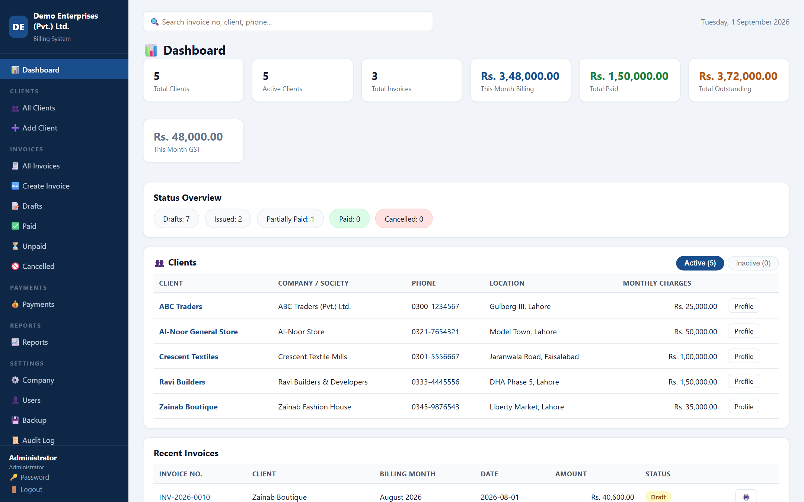

# Invoice & Billing Management System

A complete billing system for service businesses — clients stored once, monthly invoices generated automatically with units × rate, fixed charges and GST, printable A4 invoices, payment tracking and reports.

**[Live demo](https://billsuite.vercel.app)** · Login: `admin` / `admin123`



## Features

**Clients & billing**
- Client directory with contact, NTN/STRN, billing address
- Recurring monthly invoices with per-client service items
- Automatic calculation: units × rate, fixed monthly charges, GST %
- Invoice numbering with configurable prefix
- Discounts, partial payments, outstanding balance per client

**Documents**
- Professional A4 invoice layout — print or save as PDF
- Company logo, bank details, authorised signatory, footer note

**Payments & reports**
- Record payments (cash / bank / online) with reference and date
- Outstanding, paid and overdue tracking
- Monthly revenue, client-wise and service-wise reports

**Administration**
- Three roles: admin, accountant, viewer
- User management, password change, audit log
- One-click database backup download

## Tech stack

Python 3 · Flask · SQLite · Jinja2 · HTML/CSS/JS · Gunicorn + Nginx (VPS) · Vercel (serverless)

## Run locally

```bash
python -m venv venv
venv\Scripts\activate        # Windows
pip install -r requirements.txt
python app.py
```

Open <http://localhost:5000> and sign in with `admin` / `admin123`.
Demo data (clients, invoices, payments) is included. To reset it: `python seed_demo.py`.

## Deploy

- **Vercel:** `vercel --prod` — `api/index.py` + `vercel.json` are included. The bundled demo database is copied to `/tmp` on cold start, so edits are temporary in serverless mode.
- **VPS:** run with Gunicorn behind Nginx (see `DEPLOYMENT.md`).

## Project structure

```
app.py            Flask application and routes
db.py             Database helpers, schema init, audit log
clients.py        Client management
invoices.py       Invoice generation and items
reports.py        Reports and outstanding calculations
settings_users.py Company settings and user accounts
decorators.py     Role-based access control
schema.sql        Database schema
templates/        Jinja2 templates
static/           CSS, JS, logo assets
```

## Notes

This repository ships with a demo database for instant evaluation. Replace `SECRET_KEY` and the demo credentials before any real deployment.

## License

MIT © 2026 Ahsan Haroon
